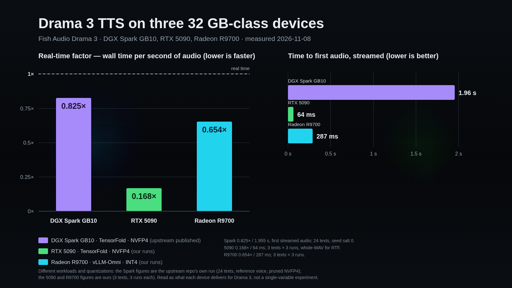

# drama-vllm-omni

**Fish Audio Drama 3 text-to-speech, running on three different 32 GB-class devices** — a DGX Spark (GB10),
an RTX 5090, and a Radeon AI PRO R9700. The Spark path is upstream's; the CUDA desktop build and the whole
AMD ROCm path are here, both built and measured rather than sketched.



Real-time factor is **wall time per second of audio — lower is faster**. `1.0` is exactly real time: the 5090
runs about six times faster than playback, the Radeon about 1.5×, and the Spark sits right at real time.

| | DGX Spark GB10 | RTX 5090 | Radeon R9700 |
|---|---:|---:|---:|
| engine | TensorFold · NVFP4 | TensorFold · NVFP4 | vLLM-Omni · INT4 |
| real-time factor | **0.825** | **0.168** | **0.654** |
| first audio, streamed | 1.955 s | **64 ms** | 287 ms |
| weights on disk | 20.8 GB | 21 GB | 24 GB |
| peak device memory | 19.35 GB | 20.5 GB | 29.6 GB |
| cold start | 26 s | ~10 s | ~95 s (warm cache) / ~5 min first run |
| numbers from | [upstream repo](docs/sources.md), 24 texts | this repo, 3 texts × 3 runs | this repo, 3 texts × 3 runs |

In practice: the 5090 is a live-conversation engine; the Radeon and the Spark synthesise around or a little
faster than playback, which suits narration, batch scene work, and anything that can buffer.

## What is in here

| file | what it gives you |
|---|---|
| [`docs/INSTALL-CUDA.md`](docs/INSTALL-CUDA.md) | a fresh Arch-based desktop with an RTX 5090 → a serving engine: packages, CUDA/Zig versions, build, weights, serve flags, and every gotcha hit on the way |
| [`docs/BENCH-5090.md`](docs/BENCH-5090.md) | the CUDA numbers: latency, real-time factor, streamed first chunk, speaker tags, VRAM, curl repro, control-script transcript |
| [`docs/BENCH-R9700.md`](docs/BENCH-R9700.md) | the ROCm recipe: the exact vLLM-Omni install, **the kernel that has to be disabled**, memory budget, measured table, and why the FP8 checkpoint will not fit |
| [`scripts/drama3-service.sh`](scripts/drama3-service.sh) | idempotent `start|stop|status|restart` for the CUDA engine — GPU-locked, safe to call from a UI toggle |
| [`scripts/bench-drama3.py`](scripts/bench-drama3.py), [`scripts/bench-r9700.py`](scripts/bench-r9700.py) | the stdlib harnesses behind both tables (they start and stop nothing) |
| [`scripts/check-speaker-tags.py`](scripts/check-speaker-tags.py) | verifies `<|speaker:N|>` really changes voice, with a pitch measurement per turn |
| [`bench/`](bench/) | raw run logs and small audio takes so the tables are auditable |

## The two paths, in one paragraph each

**CUDA (fast path).** TensorFold's native engine, built for the card, with the NVFP4 pruned weights. Serve with
`scripts/drama3-service.sh start`; it answers `POST /v1/audio/speech` on `127.0.0.1:18793` with model id
`fishaudio/drama-3`. Whole replies are synthesised before the first byte, so ask for streaming
(`response_format=pcm`, `stream=true`) if you want the 64 ms first chunk. Full build:
[`docs/INSTALL-CUDA.md`](docs/INSTALL-CUDA.md).

**ROCm (backup / narration path).** vLLM 0.33 ROCm wheel + vLLM-Omni serving `fishaudio/drama-3-int4`. The FP8
checkpoint is 36.9 GiB of stage-0 weights and does not fit 32 GB; the INT4 one (24 GB) does. **The load fails
until you disable one kernel:**

```bash
export VLLM_DISABLED_KERNELS=RDNAHybridW4A16LinearKernel
vllm serve <int4-checkpoint-path> --omni --port 8091 --gpu-memory-utilization 0.85 --max-num-seqs 4
```

That kernel expects zero-points packed `[N//8, K//G]` while the checkpoint stores them per row, so it trips
`AssertionError: zp row stride 1536 must match scales 16`. Disabling it lets vLLM fall back to another W4A16
kernel and the model serves. Full recipe, memory maths and caveats: [`docs/BENCH-R9700.md`](docs/BENCH-R9700.md).

## Wiring it to an assistant

Both engines expose the same OpenAI-style route, so a caller only has to try them in order and fall back to a
hosted TTS when neither answers. Two things bite:

- **The model id comes from `GET /v1/models`, never from a constant.** The CUDA build reports
  `fishaudio/drama-3`; vLLM reports the checkpoint *path*. A hardcoded id breaks the other engine.
- **A cold AMD start takes ~95 s.** Start it in the background and let that turn fall through, rather than
  blocking a reply on it.

Reference implementation (an assistant that prefers local speech, then a hosted fallback):
[`integrations/local-tts`](https://github.com/flashosophy/eva-core/tree/master/integrations/local-tts).

## Where the numbers come from

The **Spark measurements, the engine and the NVFP4 weights are not ours**. They come from
[`plotarmordev/drama-tensorfold`](https://github.com/plotarmordev/drama-tensorfold), the recipe this repo builds on:

- repo: <https://github.com/plotarmordev/drama-tensorfold>
- the GB10 figures above are that project's NVFP4 arm with a reference voice (γ 1.5), p50: real-time factor
  **0.825**, first audio **1.955 s**, 24 texts at seed salt 0, 0 failed takes of 96 —
  [`results/full-vs-quant-01/`](https://github.com/plotarmordev/drama-tensorfold/tree/main/results/full-vs-quant-01)
  (`tables.md`, `card-section.md`)
- weights: [`plotarmordev/drama-3-NVFP4-Pruned`](https://huggingface.co/plotarmordev/drama-3-NVFP4-Pruned);
  the model itself: [`fishaudio/drama-3`](https://huggingface.co/fishaudio/drama-3)

Our contribution is the CUDA desktop build, the measured 5090 numbers, and the whole ROCm path — upstream
covers GB10 and Apple silicon, not a Radeon.

**The three columns are not one controlled experiment.** Different engines, different quantizations (pruned
NVFP4 vs full INT4), different workloads (their 24 texts vs our 3, three runs each), and roughly 2.8× difference
in memory bandwidth between the CUDA card and the Radeon. Read the table as *what each device delivers for
Drama 3* and nothing finer.

## Licence and shape of the model

Code here is Apache-2.0. Drama 3 itself is **35B parameters, 3B active** (MoE text backbone, hybrid full +
linear attention, 10-codebook codec) and its weights are under Fish Audio's own licence
([FACL v1.0](https://huggingface.co/fishaudio/drama-3)) — fine for personal/internal use, with consent rules
for cloned voices and separate terms for third-party hosted generation. Speaker tags `<|speaker:0|>` …
`<|speaker:15|>` carry up to 16 characters in one text; reference-clip cloning is supported by both runtimes.
