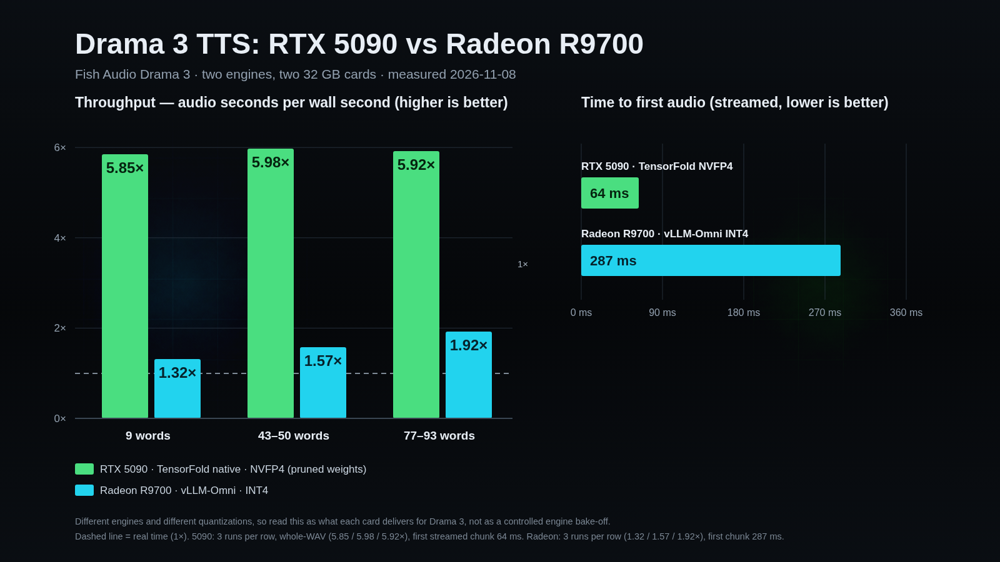

# drama-vllm-omni

**Fish Audio Drama 3 text-to-speech, with working recipes for two different 32 GB cards** — an NVIDIA
CUDA path (TensorFold, NVFP4) and an AMD ROCm path (vLLM-Omni, INT4). Both were built and measured;
neither is a sketch.



Measured 2026-11-08 on one card of each kind. Read it as *what each card delivers for Drama 3* rather than
a controlled engine bake-off: different engines, different quantizations (NVFP4 pruned vs INT4), and the
CUDA card has roughly 2.8× the memory bandwidth.

| | RTX 5090 · TensorFold · NVFP4 | Radeon R9700 · vLLM-Omni · INT4 |
|---|---:|---:|
| throughput (audio s per wall s) | **5.85 – 5.98×** | **1.32 – 1.92×** |
| first audio, streamed | **64 – 113 ms** | **287 ms** |
| short sentence, warm | **0.6 s** | 2.4 s |
| weights | 21 GB (pruned NVFP4) | 24 GB (INT4) |
| VRAM at rest | 20.5 GB | 29.6 GB |
| cold start | ~10 s | ~95 s warm cache / ~5 min first run |

What that means in practice: the CUDA path is a live-conversation engine; the ROCm path synthesises faster
than playback, which suits narration and batch scene work.

## What is in here

| file | what it gives you |
|---|---|
| [`docs/INSTALL-CUDA.md`](docs/INSTALL-CUDA.md) | a fresh Arch-based desktop with an RTX 5090 → a serving engine: packages, CUDA/Zig versions, build, weights, serve flags, and every gotcha hit on the way |
| [`docs/BENCH-5090.md`](docs/BENCH-5090.md) | the CUDA numbers: latency, real-time factor, streamed first chunk, speaker tags, VRAM, curl repro, control-script transcript |
| [`docs/BENCH-R9700.md`](docs/BENCH-R9700.md) | the ROCm recipe: the exact vLLM-Omni install, the **kernel that has to be disabled**, memory budget, measured table, and why it can't run the FP8 checkpoint |
| [`scripts/drama3-service.sh`](scripts/drama3-service.sh) | idempotent `start|stop|status|restart` for the CUDA engine — GPU-locked, safe to call from a UI toggle |
| [`scripts/bench-drama3.py`](scripts/bench-drama3.py), [`scripts/bench-r9700.py`](scripts/bench-r9700.py) | the stdlib harnesses behind both tables (they start and stop nothing) |
| [`scripts/check-speaker-tags.py`](scripts/check-speaker-tags.py) | verifies `<|speaker:N|>` actually changes voice, with a pitch measurement per turn |
| [`bench/`](bench/) | raw run logs and small audio takes so the tables are auditable |

## The two paths, in one paragraph each

**CUDA (fast path).** TensorFold's native engine, built for the card, with the NVFP4 pruned weights.
Serve with `scripts/drama3-service.sh start`; it answers `POST /v1/audio/speech` on
`127.0.0.1:18793` with model id `fishaudio/drama-3`. Whole replies are synthesised before the first byte,
so use streaming (`response_format=pcm`, `stream=true`) if you want the 64–113 ms first chunk. Full build:
[`docs/INSTALL-CUDA.md`](docs/INSTALL-CUDA.md).

**ROCm (backup / narration path).** vLLM 0.33 ROCm wheel + vLLM-Omni, serving `fishaudio/drama-3-int4`.
The FP8 checkpoint (36.9 GiB of stage-0 weights) does not fit 32 GB; the INT4 one (24 GB) does. **The load
fails until you disable one kernel:**

```bash
export VLLM_DISABLED_KERNELS=RDNAHybridW4A16LinearKernel
vllm serve <int4-checkpoint-path> --omni --port 8091 --gpu-memory-utilization 0.85 --max-num-seqs 4
```

That kernel expects zero-points packed `[N//8, K//G]` and the checkpoint stores them per row, so it trips
`AssertionError: zp row stride 1536 must match scales 16`. Disabling it lets vLLM fall back to another
W4A16 kernel and the model serves. Full recipe, memory maths and caveats:
[`docs/BENCH-R9700.md`](docs/BENCH-R9700.md).

## Wiring it to an assistant

Both engines expose the same OpenAI-style route, so a caller only has to try them in order and fall back
to a hosted TTS when neither answers. The engine's own `GET /v1/models` is the source of truth for the
model id — a CUDA build reports `fishaudio/drama-3` while vLLM reports the checkpoint path, so never
hardcode it. A cold AMD start takes ~95 s, so start it in the background and let that turn fall through
rather than blocking a reply on it.

Reference implementation (an assistant that prefers local speech, then a hosted fallback):
[`integrations/local-tts`](https://github.com/flashosophy/eva-core/tree/master/integrations/local-tts).

## Licence and shape of the model

Code here is Apache-2.0. Drama 3 itself is **35B parameters, 3B active** (MoE text backbone, hybrid full +
linear attention, 10-codebook codec) and its weights are under Fish Audio's own licence
([FACL v1.0](https://huggingface.co/fishaudio/drama-3)) — fine for personal/internal use, with consent
rules for cloned voices and separate terms for third-party hosted generation. Speaker tags
`<|speaker:0|>` … `<|speaker:15|>` carry up to 16 characters in one text; reference-clip cloning is
supported by both runtimes.
