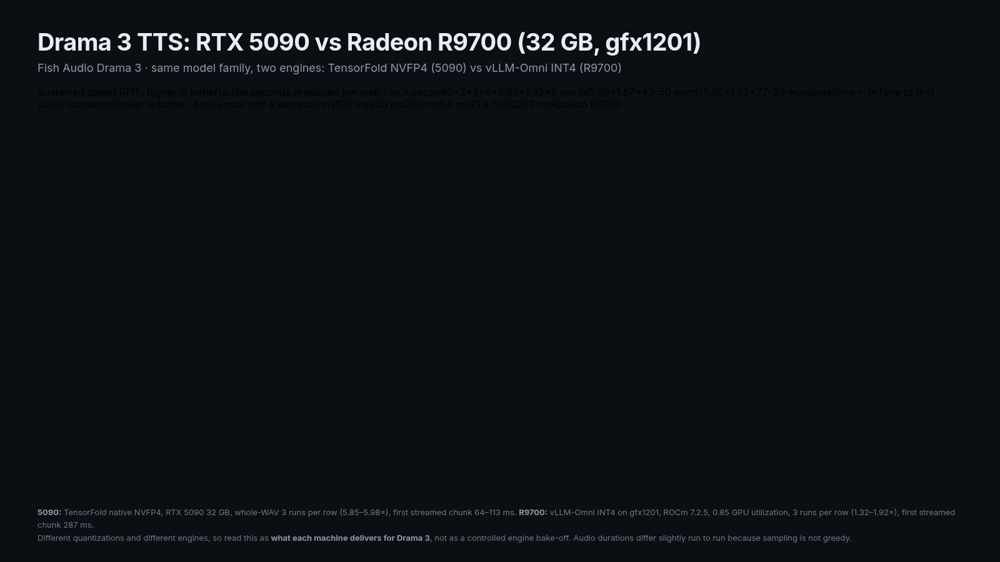

# drama-vllm-omni

Fish Audio Drama 3 text-to-speech on cards like the Radeon 9700 pro.

Measured on one RTX 5090 (sm_120) with TensorFold's native NVFP4 engine:

- [`docs/BENCH-5090.md`](docs/BENCH-5090.md) — warm-server benchmark: latency, real-time
  factor (~5.8×), streamed first-chunk latency (~0.07 s), speaker tags, VRAM, curl repro,
  control-script transcript.
- [`docs/INSTALL-RIPPER.md`](docs/INSTALL-RIPPER.md) — fresh Omarchy machine to a serving
  engine: pacman names, CUDA/Zig versions, build commands, weights, serve flags, gotchas.
- `scripts/drama3-service.sh` — idempotent `start|stop|status|restart` for the engine on
  `ripper`, GPU-locked, safe to drive from a UI toggle.
- `scripts/bench-drama3.py`, `scripts/check-speaker-tags.py` — the stdlib harnesses that
  produced the numbers (they start and stop nothing).
- `bench/` — the raw run log (`bench.json`, `speakers.json`) and three audio takes under 1 MB.

## What this repo contains

| doc | what it covers |
|---|---|
| [`docs/INSTALL-RIPPER.md`](docs/INSTALL-RIPPER.md) | rebuild on an Omarchy/Arch box with an RTX 5090 (TensorFold, NVFP4) |
| [`docs/BENCH-5090.md`](docs/BENCH-5090.md) | measured 5090 numbers: RTF 5.85–5.98×, first streamed chunk 64–113 ms |
| [`docs/BENCH-R9700.md`](docs/BENCH-R9700.md) | **Drama 3 on a 32 GB Radeon (gfx1201)**, vLLM-Omni + INT4: RTF 1.32–1.92×, first audio 287 ms |
| [`scripts/drama3-service.sh`](scripts/drama3-service.sh) | start/stop/status for the TensorFold engine (GPU-locked) |
| [`scripts/bench-drama3.py`](scripts/bench-drama3.py), [`scripts/bench-r9700.py`](scripts/bench-r9700.py) | the benchmark harnesses behind both tables |

### Two working paths, one blocker each

- **RTX 5090 (CUDA, TensorFold, NVFP4):** fast (≈5.9× realtime). Builds natively on Linux; the 21 GB pruned weights
  are the recommended ones.
- **Radeon AI PRO R9700 32 GB (ROCm, vLLM-Omni, INT4):** works, ≈1.3–1.9× realtime, first audio 287 ms. The load dies
  on a stride assertion in vLLM's RDNA hybrid W4A16 kernel until you set
  `VLLM_DISABLED_KERNELS=RDNAHybridW4A16LinearKernel`. Full recipe and every flag in
  [`docs/BENCH-R9700.md`](docs/BENCH-R9700.md).

